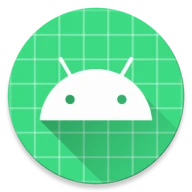

# PhonePointer

<p align="center">
  
</p>

**Transform your smartphone into a gyroscopic air-mouse and trackpad for external displays.**

PhonePointer enables seamless cursor control on external displays connected to your Android device. Using your phone's touchscreen as a trackpad and gyroscope for air-mouse functionality, you can navigate and interact with content on a secondary display as naturally as using a laptop touchpad.

---

## ✨ Features

- **🖱️ Touchpad Mode** — Use your phone screen as a multi-touch trackpad
- **🎯 Gyroscope Control** — Move the cursor by tilting your phone (air-mouse style)
- **📱 External Display Support** — Full cursor and input support for connected displays
- **⌨️ Virtual Keyboard** — On-screen keyboard overlay for text input on external display
- **📲 App Launcher** — Launch and manage apps directly on your external display
- **🔙 Navigation Controls** — Quick access to Back, Home, and Recents buttons
- **⚙️ Customizable Sensitivity** — Adjust swipe and gyro sensitivity per-axis
- **🔅 Screen Dimming** — Dim phone screen while using touchpad to save battery
- **📊 Running Apps View** — See and switch between apps running on external display

---

## 📋 Requirements

- **Android 10+ (Pixel 10 Pro XL on Android 16 tested currently)**
- **Shizuku** — Required for input injection on external displays
  - [Download Shizuku from GitHub](https://github.com/RikkaApps/Shizuku)
- **System Alert Window Permission** — For cursor overlay
- **USB-C to HDMI/DisplayPort** or **Wireless Display** connection

---

## 🚀 Getting Started

### 1. Install Shizuku
Download and set up [Shizuku](https://github.com/RikkaApps/Shizuku) on your device. You can start Shizuku via:
- **Wireless ADB** (no PC required after initial setup)
- **USB Debugging** (requires PC connection)

### 2. Install PhonePointer
Build from source or install the APK.

### 3. Grant Permissions
- Launch PhonePointer and grant **Shizuku permission** when prompted
- Grant **Display over other apps** permission for cursor overlay

### 4. Connect External Display
Connect your phone to an external display via USB-C adapter or wireless casting.

### 5. Start Using
The app will automatically detect the external display and attach the cursor. Use your phone screen as a trackpad!

---

## 🎮 Controls

| Action | Gesture |
|--------|---------|
| Move cursor | Swipe on touchpad (or tilt phone if gyro enabled) |
| Left click | Single tap |
| Long press / Right click | Long press |
| Scroll | Two-finger swipe |
| Back | Tap "Back" button |
| Home | Tap "Home" button |
| Recent Apps | Tap "Recents" button |
| Open App Launcher | Tap "Apps" button |
| Show Keyboard | Tap "Keyboard" button |

---

## 🛠️ Building from Source

```bash
# Clone the repository
git clone https://github.com/YOUR_USERNAME/PhonePointer.git
cd PhonePointer

# Build with Gradle
./gradlew assembleDebug

# Install on device
./gradlew installDebug
```

---

## 📦 Dependencies

- [Shizuku API](https://github.com/RikkaApps/Shizuku) — Input injection on external displays
- [LSPosed HiddenApiBypass](https://github.com/LSPosed/AndroidHiddenApiBypass) — Access hidden Android APIs
- AndroidX AppCompat & Material Components

---

## 🙏 Credits & Acknowledgments

This project builds upon the work of several amazing open-source projects:

### **DroidOS**
Taskbar switching logic adapted from [DroidOS](https://github.com/Katsuyamaki/DroidOS/tree/main) by Katsuyamaki.  
Licensed under **GNU General Public License v3.0 (GPLv3)**.

### **Taskbar**
Framework code and desktop mode input controller architecture inspired by [Taskbar](https://github.com/farmerbb/Taskbar) by farmerbb.  
Licensed under **Apache License 2.0**.

Thank you to these projects for making this possible!

---

## 📄 License

This project is licensed under the **GNU General Public License v3.0 (GPLv3)**.

This means you are free to:
- ✅ Use this software for any purpose
- ✅ Study and modify the source code
- ✅ Distribute copies of the original software
- ✅ Distribute your modified versions

Under the following conditions:
- 📋 Source code must be made available when distributing
- 📋 Modifications must be released under GPLv3
- 📋 Changes must be documented
- 📋 Original license and copyright notices must be preserved

See the [LICENSE](LICENSE) file for the full license text, or visit [GNU GPLv3](https://www.gnu.org/licenses/gpl-3.0.en.html).

> **Note:** This project incorporates code from [DroidOS](https://github.com/Katsuyamaki/DroidOS), which is licensed under GPLv3, making this a derivative work under the same license.

---

## 🤝 Contributing

Contributions are welcome! Please feel free to submit issues and pull requests.

1. Fork the repository
2. Create your feature branch (`git checkout -b feature/amazing-feature`)
3. Commit your changes (`git commit -m 'Add amazing feature'`)
4. Push to the branch (`git push origin feature/amazing-feature`)
5. Open a Pull Request

---
